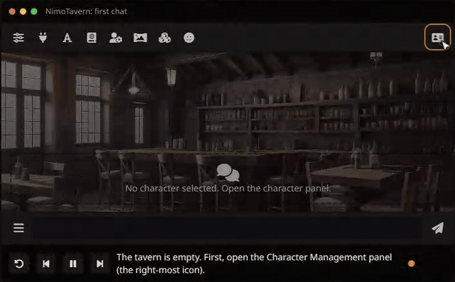
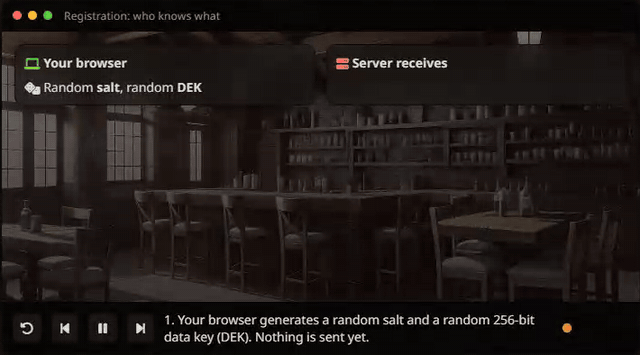
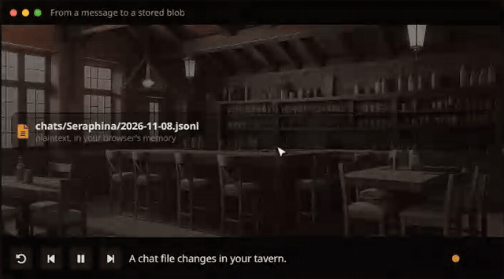
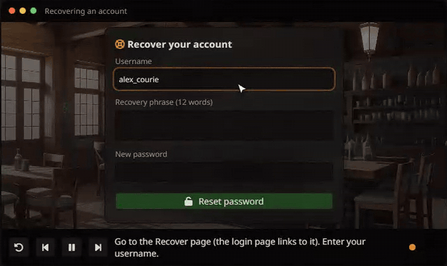
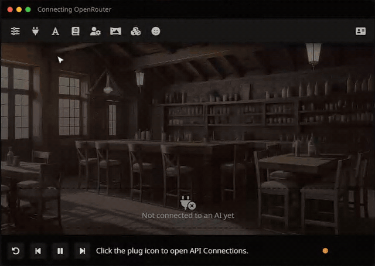
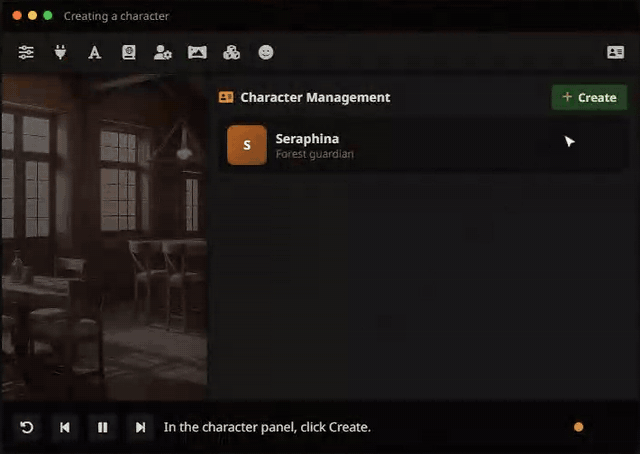
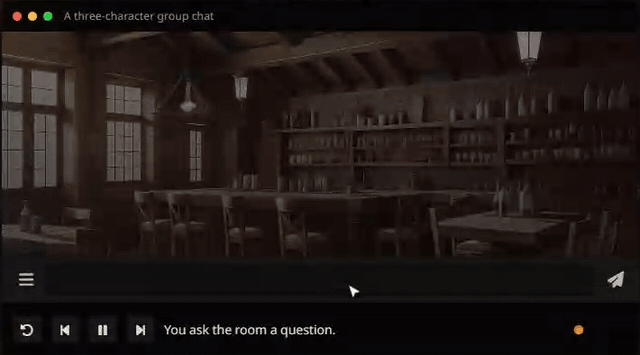
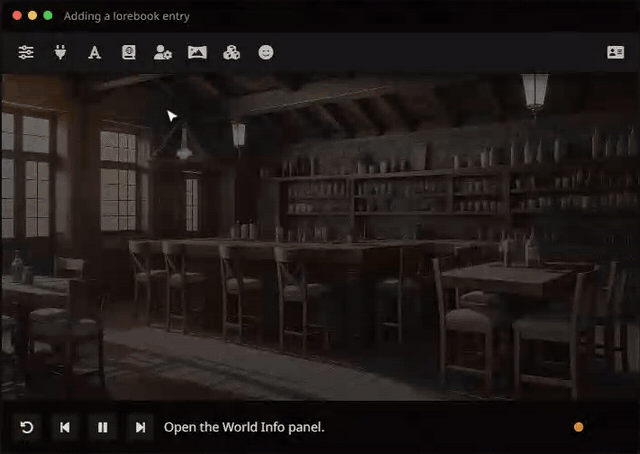
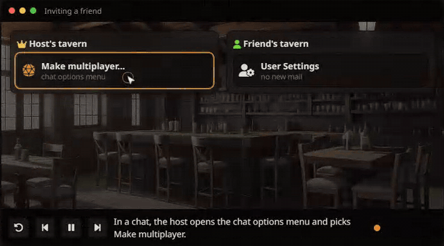
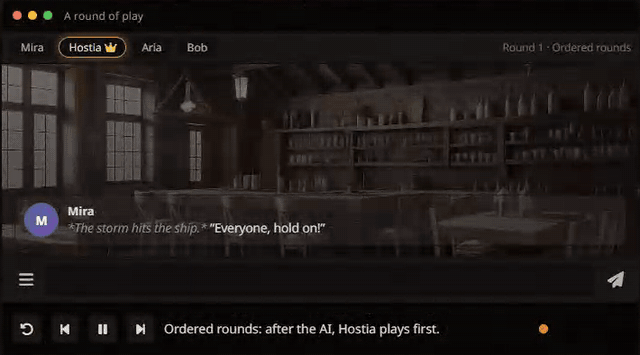

<div align="center">

# NimoTavern

### Your tavern. Your eyes only.

**A free, public, end-to-end encrypted [SillyTavern](https://github.com/SillyTavern/SillyTavern), with nothing to install.**

[**nimorp.lol**](https://nimorp.lol) · [Wiki](https://nimorp.lol/wiki) · [How the encryption works](https://nimorp.lol/wiki/crypto) · [Privacy](https://nimorp.lol/privacy)



</div>

---

NimoTavern is SillyTavern, the roleplay and chat frontend for AI models, hosted for everyone. You make an account with just a username and a password, and you get the full SillyTavern in your browser on any device.

The difference from a normal hosted instance is that **the person running the server cannot read your data**. Your chats, characters, personas, lorebooks, settings and API keys are encrypted in your browser before they're saved. The server only ever stores unreadable blobs. (Multiplayer sessions are the one opt-in exception; see below.)

- 🔒 **End-to-end encrypted.** AES-256-GCM, with a key derived from your password (Argon2id). Even file names are hidden.
- 🔑 **Your API keys stay yours.** Requests to OpenRouter, OpenAI, Claude, Gemini, DeepSeek and others go straight from your browser to the provider. They never pass through NimoTavern (the only exception is a key you choose to give a [multiplayer](#multiplayer-nimotavern-only) session).
- 🕵️ **No email, no tracking, no ads.** No IPs, user agents or access logs are stored.
- ⚡ **Fast.** The tavern runs locally in your browser, so swiping, editing and switching characters feels instant.
- 🔄 **Synced across devices.** Log in on your phone and your PC. You can export everything as a standard SillyTavern backup whenever you want.
- 🎲 **Multiplayer.** Up to 6 friends and one AI character, turn by turn ([see below](#multiplayer-nimotavern-only)).
- 🧩 **The SillyTavern you know.** Character cards, group chats, World Info, presets, personas, themes, Quick Replies, regex, extensions and more.

## How it works

A normal SillyTavern runs a Node.js server that reads your files and forwards your prompts and API keys, so whoever hosts it can see everything. **NimoTavern moves that server into your browser.**

```
Your browser                                                 NimoTavern server
┌─────────────────────────────────────────────┐              ┌──────────────────────────┐
│ SillyTavern interface (unchanged)           │              │ accounts and sessions    │
│        │ fetch('/api/...')                  │              │ encrypted blobs only     │
│        ▼                                    │  ciphertext  │ (PostgreSQL)             │
│ Service Worker                              │ ───────────► │ optional no-log relay    │
│  • SillyTavern's own server code            │              └──────────────────────────┘
│  • virtual file system in memory            │
│  • AES-256-GCM encryption + sync            │   prompts + API keys
│  • calls the AI provider directly ──────────┼──────────────────────────► AI provider
└─────────────────────────────────────────────┘
```

SillyTavern's real server code (`src/endpoints/*`) runs inside a Service Worker, on top of a virtual file system. Every file is compressed and encrypted before it's uploaded, and decrypted only in your browser.

<table>
<tr>
<td width="50%" valign="top">

**What the server learns when you sign up**

Your browser creates the keys. The server receives your username, a login proof it can't reverse, and two locked copies of your data key. It never sees your password, your keys or your recovery phrase.

</td>
<td width="50%" valign="top">

**What happens when a file is saved**

A chat is compressed, encrypted with a fresh random IV, and stored under an ID that hides its name. A database leak exposes only random-looking bytes.

</td>
</tr>
<tr>
<td></td>
<td></td>
</tr>
</table>

### The key setup in short

- **Password** → Argon2id (64 MiB, t=3) → HKDF → a **key-encryption key**, which never leaves the browser, and a **login proof**, which the server stores hashed with scrypt.
- A random 256-bit **data key** encrypts your files. The server stores it only in locked form: once with your password's key, and once with your **12-word recovery phrase**.
- **Each file** is compressed with deflate, then encrypted with AES-256-GCM, with its blob ID as associated data. The blob ID is HMAC-SHA256 of the file's path, so even file names are hidden.
- **Changing your password** re-locks the data key. Your data doesn't need to be encrypted again, and your other devices are logged out.
- **Default content** (themes, backgrounds, Seraphina, tokenizers) is public and shared by reference, never copied per user.

> [!IMPORTANT]
> Because nobody else holds your key, **if you lose both your password and your recovery phrase, your data cannot be recovered**, not even by us. You get the phrase when you sign up, so keep it safe.

<div align="center">

</div>

## The full SillyTavern

Everything you'd use in a local SillyTavern works, because it *is* SillyTavern's code. The [wiki](https://nimorp.lol/wiki) explains every feature step by step, with animations like these:

<table>
<tr>
<td width="50%"><b>Connect any AI provider</b><br></td>
<td width="50%"><b>Create or import characters</b> (PNG, JSON, YAML, CHARX)<br></td>
</tr>
<tr>
<td><b>Group chats</b><br></td>
<td><b>Lorebooks and World Info</b><br></td>
</tr>
</table>

## Multiplayer (NimoTavern only)

NimoTavern's own feature: **up to 6 players**, each with their own persona, roleplay with one AI character **turn by turn**, like a tabletop game. Players can be online together or take their turns at their own pace.

- **Hosting:** the host turns any chat into a session from the chat options menu. They set the world setting, the lorebooks, the turn rules (ordered rounds, free rounds or strict alternation, with an optional turn timer) and a **separate AI connection just for multiplayer**.
- **Joining:** friends are invited by username. The invite lands in their **Account → Mailbox**, with a badge on the Account button. Accepting adds the session to their character list like any other chat.
- **What players see:** only what's on screen. The character definition, world setting, lorebooks and API key stay with the host.

<div align="center">
 
</div>

> [!WARNING]
> **Multiplayer is not end-to-end encrypted.** To run the AI for the whole group, even when the host is offline, the server reads the session while it writes the prompt, using the host's multiplayer key. Sessions are encrypted at rest with their own key, never logged, and deleted when the host ends them (or after 90 days without activity). Solo chats don't change: they stay end-to-end encrypted. [Details](https://nimorp.lol/privacy#multiplayer)

### Limitations, honestly

- **You trust the code that's served to you**, like with any web app. The code is public here, so you can check what it does ([how to verify it](https://nimorp.lol/wiki/verify)).
- **Your AI provider sees your prompts.** That's unavoidable with any frontend.
- **Some providers block requests from browsers.** For those, there's an **optional relay**, which is off by default. With it on, that request passes through the server's memory without being logged or stored, but you trust the server for that request.
- **Server-side ML features** (vector storage, captioning, classification) are disabled, and third-party extensions that need a server-side install aren't available.
- If you can run SillyTavern on your own computer, that's still the most private option. NimoTavern is for when you can't, or when you want your tavern on every device.

## Running your own

NimoTavern doesn't modify SillyTavern's code. It bundles it, and applies a few build-time patches that fail loudly if upstream changes.

```bash
npm ci                      # SillyTavern deps + NimoTavern build deps
node nimo/build-lib.mjs     # SillyTavern's webpack lib.js -> dist/lib.js
node nimo/build.mjs all     # Service Worker, pages and wiki -> nimo/dist
node nimo/server/index.js   # start the server (needs PostgreSQL)
```

| Folder | What's inside |
| --- | --- |
| `nimo/sw/` | The Service Worker: mounts SillyTavern's routers, Node shims (`fs`, `express`, `crypto`, …), the virtual file system and the encrypted sync |
| `nimo/shared/` | Key derivation and encryption (Argon2id, HKDF, AES-GCM, HMAC IDs) |
| `nimo/server/` | Express + PostgreSQL: accounts, blob storage, the optional relay, page serving |
| `nimo/web/` | The NimoTavern pages (home, login, register, recover, account, privacy) and the wiki |

The server reads its settings from environment variables: `NIMO_SECRET`, `DATABASE_URL`, `PORT`, `COOKIE_SECURE`, `REGISTRATION_OPEN`, `DEFAULT_QUOTA_BYTES`, `TURNSTILE_SITE_KEY`, `TURNSTILE_SECRET` and `SOURCE_URL`. See [`nimo/README.md`](nimo/README.md) for the technical details.

To update from upstream, merge SillyTavern's `release` branch, rebuild, and run the end-to-end checks.

## Credits

NimoTavern is built by the Nimo team on top of **[SillyTavern](https://github.com/SillyTavern/SillyTavern)**, the open-source LLM frontend created and maintained by the SillyTavern team and its many contributors. Everything you know and love in the app is their work, and all credit for it goes to them. The Nimo team adds the hosting, accounts and end-to-end encryption around it.

NimoTavern is an independent project. It is **not affiliated with or endorsed by the SillyTavern team.** Please don't ask them for support with NimoTavern.

- SillyTavern: [website](https://sillytavern.app) · [GitHub](https://github.com/SillyTavern/SillyTavern) · [docs](https://docs.sillytavern.app/) · [Discord](https://discord.gg/sillytavern) · [r/SillyTavernAI](https://reddit.com/r/SillyTavernAI)

## License

[AGPL-3.0](LICENSE), the same license as SillyTavern.
